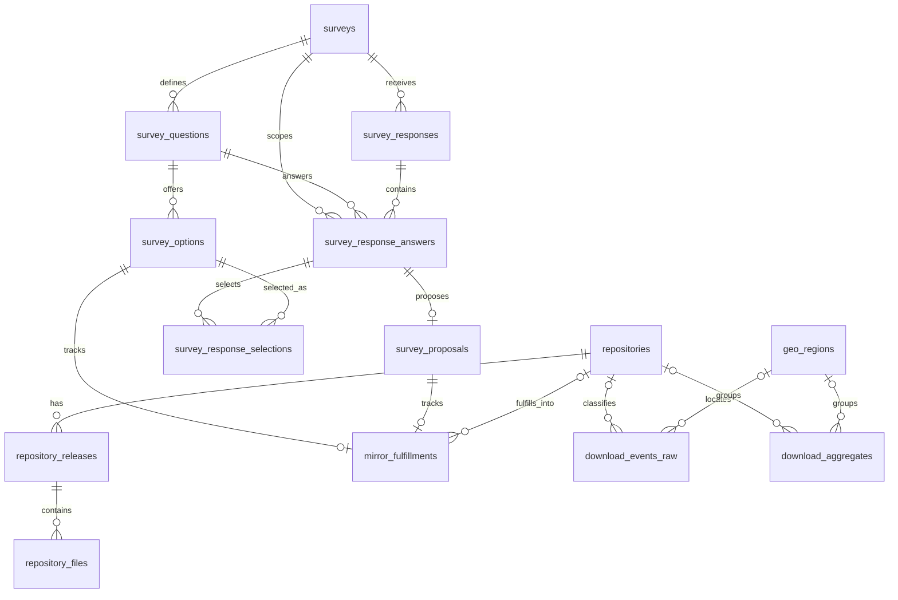

# Rancangan Database Pinguin Dinus

Dokumen ini merinci rancangan PostgreSQL untuk backend portal Pinguin Dinus.
Database menyimpan metadata portal, survei, status tindak lanjut, audit, dan
analytics teragregasi. File ISO tetap berada di layanan mirror UDINUS.

> **Status:** migrasi `000001`–`000007` mencakup catalog, survey, audit,
> analytics, dan field operasional worker di PostgreSQL Docker. Auth masih
> JWT HS256 per-operator dengan subject/role dan masa berlaku. Kebijakan
> retensi telah disetujui pemilik data; verifikasi produksi dan migrasi target
> tetap perlu dilakukan sebelum rilis. Jangan anggap migrasi development
> sebagai migrasi produksi.

## Target PostgreSQL lokal

PostgreSQL development berjalan di Docker dan menerima koneksi host hanya pada
`localhost:5432` (`127.0.0.1:5432`). Compose menyimpan data dalam named volume.
Jalankan `docker compose up -d postgres` untuk menyalakan database saja, atau
`docker compose up -d --build` untuk menyalakan seluruh stack aplikasi. Backend yang
berjalan di host membaca konfigurasi dari environment, bukan dari source code.

```dotenv
DB_HOST=127.0.0.1
DB_PORT=5432
DB_NAME=pinguin_dinus
DB_USER=pinguin_app
DB_PASSWORD=<password-lokal>
DB_SSLMODE=disable
```

DSN Go dibentuk saat runtime dari nilai tersebut. `.env` pada root repository
menyediakan variabel untuk Compose dan backend, dan tidak boleh di-commit.
`sslmode=disable` hanya untuk development lokal. Pada `compose.yaml` root, service
`api` dan `worker` terhubung ke PostgreSQL menggunakan hostname internal `DB_HOST=postgres`.
Jika backend dijalankan secara native dari host (standalone), gunakan `DB_HOST=127.0.0.1`.

## Konvensi skema

- Target minimum rancangan: PostgreSQL 13+; semua waktu disimpan sebagai
  `timestamptz` dalam UTC.
- Primary key menggunakan UUID (`gen_random_uuid()`); identifier publik tidak
  bergantung pada nomor urut.
- Nama tabel/kolom menggunakan `snake_case`. Status menggunakan `text` dengan
  `CHECK` constraints agar migrasi status tidak memerlukan perubahan enum PG.
- Setiap tabel domain memiliki `created_at`; resource yang dapat diedit juga
  memiliki `updated_at`.
- Foreign key eksplisit dan penghapusan menggunakan `RESTRICT` secara default.
  Penghapusan berantai hanya untuk child yang benar-benar tidak dapat berdiri
  sendiri, misalnya jawaban dari respons yang dihapus oleh retention job.
- URL unduhan mengarah ke mirror; database portal tidak menyimpan binary.
- Aplikasi runtime dan migrator sebaiknya memakai role database berbeda. Bearer
  token admin tidak mengubah privilege PostgreSQL; pembatasan per identitas admin
  belum tersedia karena runtime memakai satu secret bersama.

## ERD inti



`survey_option_results` tidak dibuat sebagai tabel sumber kedua. Untuk volume
awal, ranking dihitung dari jawaban/pilihan pada query agregat; jika kelak perlu
snapshot, tambahkan materialisasi dengan aturan refresh yang terukur.

## Status schema pada implementasi saat ini

Backend awal kini memiliki migrasi SQL bernomor untuk catalog, survey, audit,
dan analytics. Runtime memakai `LISTING_DIR` sebagai sumber listing dinamis dan
memakai tabel katalog, survei, audit, dan analytics. Runtime mencatat unduhan
portal dan importer Nginx ke `download_events_raw`; worker mengagregasi event
menjadi bucket jam per folder tingkat atas dan wilayah. Ringkasan dan timeseries
publik menghitung sumber `portal` dan `nginx`, termasuk filter slug repository
dan distribusi. Geodata event Nginx berasal dari GeoLite2 City lokal jika
`GEOIP_DB_PATH` tersedia; tanpa geodata, event memakai wilayah unknown.

`schema_migrations` mencatat versi dan checksum migrasi. Perubahan file migrasi
setelah penerapan akan ditolak; buat nomor migrasi baru untuk perubahan skema.

## Tabel katalog

| Tabel | Kolom utama | Kunci dan aturan |
|---|---|---|
| `repositories` | `id`, `slug`, `path_prefix`, `name`, `distribution`, `category`, `description`, `status`, `mirror_base_url`, `is_public`, timestamps | `slug` unik dan menjadi identitas API; `path_prefix` unik/nullable-empty dan memetakan path mirror multi-segmen ke slug. Prefix kosong berarti `slug`. Category `iso/package/tool`; status `active/hidden/retired`. `is_public=false` untuk sentinel analytics/internal. |
| `repository_releases` | `id`, `repository_id`, `version`, `released_at`, `metadata`, timestamps | FK ke repository; unique `(repository_id, version)`; JSONB metadata hanya untuk atribut upstream yang belum memiliki kolom stabil. |
| `repository_files` | `id`, `release_id`, `path`, `size_bytes`, `checksum`, `checksum_algorithm`, `download_url`, timestamps | Unique `(release_id, path)`; size non-negatif; checksum dan algorithm nullable tetapi harus terisi berpasangan. URL harus HTTPS atau skema mirror yang diizinkan. |

Index katalog: `repositories(category, status)`, `repositories(distribution)`,
partial unique `repositories(path_prefix)`,
`repository_releases(repository_id, released_at DESC)`, dan
`repository_files(release_id, path)`. Pencarian nama/deskripsi dapat dimulai
dengan PostgreSQL text search; tambahkan GIN index hanya setelah strategi
normalisasi dan query disepakati.

## Tabel survei request ISO

| Tabel | Kolom utama | Kunci dan aturan |
|---|---|---|
| `surveys` | `id`, `title`, `description`, `starts_at`, `ends_at`, `status`, timestamps | Status `draft/active/closed/archived`; `ends_at > starts_at`; hanya draft boleh mengubah struktur. |
| `survey_questions` | `id`, `survey_id`, `label`, `type`, `is_required`, `position`, timestamps | Type `single_choice/multiple_choice/short_text/long_text/iso_proposal`; unique `(survey_id, position)` dan `(id, survey_id)`. `iso_proposal` adalah jawaban teks usulan ISO dan tidak mempunyai opsi. |
| `survey_options` | `id`, `question_id`, `label`, `slug`, `upstream_url`, `is_available`, `position`, timestamps | Opsi melekat ke question; unique `(question_id, position)`; `(id, question_id)` unique agar FK pilihan respons dapat memastikan ownership. URL upstream hanya ditampilkan bila diizinkan. |
| `survey_responses` | `id`, `survey_id`, `submitted_at`, `retention_expires_at` | FK `(survey_id)`; index `(survey_id, submitted_at)`; tidak menyimpan IP/user-agent untuk identifikasi pengirim. |
| `survey_response_contacts` | `response_id`, `email`, `created_at`, `retention_expires_at` | Maksimum satu kontak per respons; terpisah supaya akses dan penghapusan PII dapat dibatasi. Email opsional dan tidak ikut hasil publik. |
| `survey_response_answers` | `id`, `survey_id`, `response_id`, `question_id`, `text_value` | FK komposit memastikan response dan question milik survey yang sama; unique `(response_id, question_id)`; teks dibatasi ukuran di API. |
| `survey_response_selections` | `answer_id`, `question_id`, `option_id` | PK `(answer_id, option_id)`; FK komposit memastikan option berasal dari question yang dijawab. Mendukung pilihan tunggal maupun jamak. |
| `survey_idempotency_keys` | `id`, `survey_id`, `key_hash`, `payload_hash`, `response_id`, `expires_at`, `created_at` | Unique `(survey_id, key_hash)`; simpan hash, bukan key mentah; response nullable selama transaksi lalu diisi; row kedaluwarsa dihapus terjadwal. |
| `survey_proposals` | `id`, `survey_id`, `answer_id`, `proposed_name`, `normalized_name`, `upstream_url`, `created_at` | Satu proposal per jawaban bertipe `iso_proposal`; index `(survey_id, normalized_name)` untuk mengelompokkan usulan serupa. Tidak menyimpan kontak di record proposal. |
| `mirror_fulfillments` | `id`, `option_id`, `proposal_id`, `status`, `priority`, `admin_note`, `repository_id`, `updated_by`, timestamps | Tepat satu dari `option_id`/`proposal_id` terisi; unique pada tiap FK; status `new/reviewing/prioritized/in_progress/fulfilled/rejected`; repository diisi saat tersedia di katalog. |

### Integritas survei

- Publish hanya diizinkan jika survei punya judul/periode valid, minimal satu
  pertanyaan, dan opsi untuk pertanyaan pilihan. `iso_proposal` menerima satu
  usulan nama ISO teks dan tidak memiliki opsi. Syarat khusus ditetapkan pada
  service domain dan/atau constraint yang memungkinkan.
- Respons hanya diterima untuk survei `active` dalam periode berlaku. Perubahan
  status dan penyimpanan respons menggunakan transaksi agar close/publish tidak
  berlomba dengan submission.
- Server memeriksa pertanyaan wajib, tipe jawaban, jumlah pilihan tunggal/jamak,
  dan kecocokan option dengan pertanyaan.
- `Idempotency-Key` disimpan sebagai hash bersama request hash dan receipt
  sampai masa deduplikasi yang ditetapkan. Key sama dengan body berbeda ditolak
  sebagai konflik. Ini melindungi retry, bukan membuktikan satu respons per orang.
- Ranking opsi dihitung dari `survey_response_selections`; total respons dapat
  berbeda dari jumlah pilihan karena respons bisa berisi usulan teks bebas.
- Proposal baru dikelompokkan memakai nama ternormalisasi untuk ditinjau admin;
  proposal menjadi target fulfillment tanpa mengubah struktur survei yang sudah
  diterbitkan. Admin dapat menautkan proposal ke repository portal saat tersedia.
- Untuk jawaban `iso_proposal`, teks disalin ke `survey_proposals.proposed_name`
  dalam transaksi; `text_value` jawaban boleh null agar tidak ada dua sumber
  kebenaran untuk nama proposal.
- Kontak opsional dibaca hanya oleh role operasional yang diizinkan; masking
  menjadi default pada dashboard.

### Tipe data dan batas kolom utama

| Kelompok kolom | Tipe SQL yang disarankan | Constraint/batas |
|---|---|---|
| Semua `id` | `uuid` | PK; default `gen_random_uuid()` kecuali join table yang memakai composite PK. |
| Slug/kode/status/category | `text` | `CHECK` untuk enum domain; unique pada slug/kode. |
| Nama/judul/label/version | `text` | Batas panjang di API (nama 200, label 500, slug 120). |
| Deskripsi/catatan admin | `text` | Nullable bila opsional; batas 5.000 karakter di API. |
| URL | `text` | Validasi scheme/host di domain adapter; tidak memakai tipe panjang tetap. |
| Ukuran file dan byte terkirim | `bigint` | `CHECK (value >= 0)`. |
| Timestamp bisnis | `timestamptz` | UTC; periode dan masa retensi eksplisit. |
| Posisi, status HTTP, priority | `integer` | Posisi mulai 0/1 secara konsisten; HTTP 100–599; priority positif. |
| `is_required`, `is_available`, completed estimate | `boolean` | Nilai eksplisit, default ditentukan di migrasi. |
| Metadata dan safe audit changes | `jsonb` | Hanya untuk struktur fleksibel; jangan menyimpan secret/PII secara bebas. |
| Email kontak | `text` | Opsional; batas 254 karakter dan format divalidasi oleh API. |
| Checksum | `text` + algorithm `text` | Simpan hasil dan algoritmanya; pasangan keduanya null atau terisi. |
| Digest sumber log/idempotency/payload | `bytea` atau `char(64)` | Digest satu arah dengan panjang tetap; bukan identifier pengguna. |

Untuk integritas jawaban, `survey_response_answers` menyimpan `survey_id` selain
dua FK parent. Tambahkan unique `(id, survey_id)` pada responses dan questions,
lalu FK komposit `(response_id, survey_id)` dan `(question_id, survey_id)`.
Pada selections, gunakan FK `(answer_id, question_id)` ke answers dan
`(option_id, question_id)` ke options. Dengan demikian database ikut mencegah
jawaban mencampur opsi antar-pertanyaan/survei.

Index survei: `survey_questions(survey_id, position)`,
`survey_options(question_id, position)`, `survey_responses(survey_id, submitted_at
DESC)`, `survey_response_answers(response_id)`, `survey_proposals(survey_id,
normalized_name)`,
`survey_response_selections(option_id)`, dan `mirror_fulfillments(status, priority)`.

## Tabel admin dan audit

| Tabel | Rancangan |
|---|---|
| `audit_logs` | `id`, `actor_identifier` nullable, `action`, `resource_type`, `resource_id`, `outcome`, `request_id`, `safe_changes` JSONB nullable, `created_at`. Append-only untuk role aplikasi; jangan menulis token, password, IP pengguna, email, atau isi jawaban. |
| Admin identities/roles | Runtime memakai token JWT HS256 individual per operator, diterbitkan lewat CLI tanpa SSO/OIDC. Claim `sub` menjadi actor audit; role yang didukung: `admin`, `survey_manager`, `response_reader`, `fulfillment_manager`, `audit_reader`. Signing key dan key rotasi ada di environment, bukan DB. |

Index audit: `(created_at DESC)`, `(actor_identifier, created_at DESC)`, dan
`(resource_type, resource_id, created_at DESC)`. Retention job memakai masa
simpan 365 hari yang disetujui untuk audit dan menghapus dalam batch. Operator
dapat mengubah nilainya lewat konfigurasi environment.

## Tabel analytics

| Tabel | Kolom utama | Kunci dan aturan |
|---|---|---|
| `geo_regions` | `id`, `country_code`, `region_code`, `country_name`, `region_name`, `latitude`, `longitude` | Unique `(country_code, region_code)`; koordinat merupakan centroid/representasi wilayah, bukan lokasi tepat. Sediakan region `Other/Unknown`. |
| `download_events_raw` | `id`, `source_key`, `source`, `occurred_at`, `file_path`, `http_status`, `bytes_sent`, `range_requested`, `completed_estimate`, `geo_region_id`, `aggregated_at`, `created_at` | `source_key` unik; runtime memakai UUID event, importer Nginx memakai digest sumber+offset. Tidak menyimpan IP atau user-agent. Raw event berakses worker saja dan retensi terbatas. |
| `download_aggregates` | `bucket_start`, `bucket_size`, `file_path_prefix`, `region_code`, `request_count`, `completed_count`, `bytes_sent`, `updated_at` | Primary key pada bucket, prefix path, dan region; counter non-negatif. Tidak dihapus retention job. |
| `worker_checkpoints` | `stream_id`, `source_position`, `updated_at`, `last_started_at`, `last_succeeded_at`, `last_batch_processed`, `last_batch_duration_ms`, `consecutive_failures`, `last_error_code` | Checkpoint transaksi agregator dan status operasional worker; endpoint admin menampilkan pending event dan status stale/degraded. |

Index analytics: `download_events_raw(occurred_at)`, partial index event pending,
path/waktu, dan retention `(created_at,id)`; serta
`download_aggregates(bucket_start,bucket_size)`, `(file_path_prefix,bucket_start)`,
dan `(region_code,bucket_start)`. Agregat di-upsert dalam
transaksi agar retry worker tidak menggandakan hitungan. Klasifikasi completed
adalah estimasi berdasar status/byte/range dan perlu divalidasi dengan operator
mirror; request bukan otomatis satu download selesai.

## Urutan migrasi

Gunakan migrasi SQL berurutan dan immutable setelah diterapkan. Nama yang
disarankan:

1. `000001_catalog.up.sql` / `.down.sql`: repositories, releases, files, index.
2. `000002_surveys.up.sql` / `.down.sql`: surveys, questions, options, responses,
   contacts, answers/selections, proposal ISO, idempotency, fulfillment,
   constraints/index.
3. `000003_audit.up.sql` / `.down.sql`: audit log dan index.
4. `000004_analytics.up.sql` / `.down.sql`: regions, sanitized raw events,
   aggregates, checkpoints, index dan sentinel “unknown”.
5. `000005_geo_country.up.sql` / `.down.sql`: normalisasi kode negara region.
6. `000006_operations.up.sql` / `.down.sql`: checkpoint worker dan index retensi.
7. `000007_repository_path_prefix.up.sql` / `.down.sql`: pemetaan path mirror bertingkat.
7. Seed data development (separate repeatable seed, not production migration):
   contoh repository/survey yang jelas ditandai dummy; jangan seed password/admin.

Down migration hanya untuk development/recovery yang terencana; production
rollback dilakukan dengan backup, forward-fix migration, atau prosedur restore,
bukan drop data secara otomatis.

## Pengaturan Docker dan koneksi

Sebelum backend dijalankan, pastikan container sehat dan port host `5432`
tersedia. Compose membatasi port ke loopback lokal dan menggunakan volume
persisten. Verifikasi dari root repository:

```powershell
docker compose ps
Test-NetConnection 127.0.0.1 -Port 5432
```

Backend API dan worker memakai konfigurasi DB yang sama melalui environment;
migrator berjalan eksplisit sebelum aplikasi. Connection pool, timeout, dan
shutdown harus mengikuti context proses Go. Kredensial lokal disimpan di `.env`
yang diabaikan Git.
